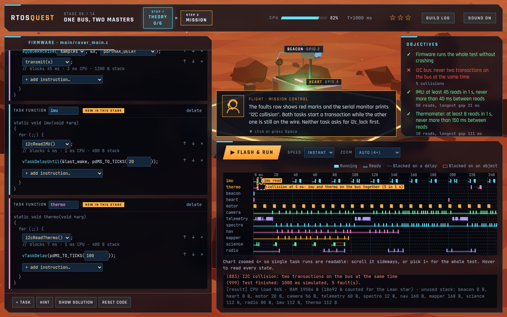
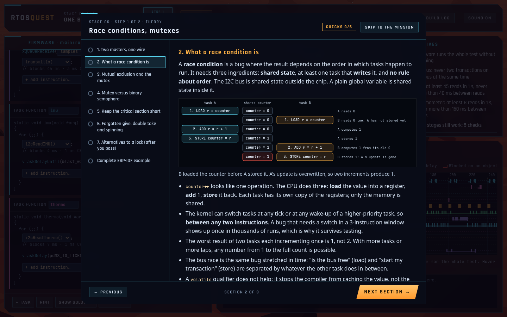

# RTOS Quest

A 3D programming game that teaches FreeRTOS on the ESP32 (ESP-IDF style). You write the firmware of a Mars rover from code blocks, a simulated kernel runs it, and a timing chart shows what every task did in every millisecond.

**Play it in the browser: <https://eoffers51.github.io/rtos-quest/>** (desktop browser, no install).



The game is one connected journey. It starts with a bench prototype that blinks two LEDs and ends with flight-ready firmware: 25 tasks on two cores. Each stage adds hardware to the rover, starts from the firmware you wrote in the stage before, and keeps checking that the older parts still work.

## How a stage works

1. **Theory.** A paged manual with diagrams, interactive widgets and check questions. It opens by itself the first time you enter a stage.
2. **Mission.** Flash the delivered code, read the chart and the serial monitor, fix the firmware, flash again. Mission control comments on what went wrong, and the chart marks the place.



A new player gets a one-minute tour of the mission screen in stage 1, before the first briefing. It can be skipped, and TOUR in the top bar starts it again in any stage.

Each stage gives up to three stars: one for meeting all objectives, one for CPU load, one for RAM. HINT gives help in steps. SHOW SOLUTION runs the reference solution, and RESTORE MINE brings your own code back.

## Stages

| # | Stage | Topic | What the rover gains |
|---|---|---|---|
| 1 | First Light | Tasks, blocking, the idle task | Status lights on a bench prototype |
| 2 | Wheels and Eyes | Priorities and preemption | Drive motors, camera, telemetry |
| 3 | Steady Pulse | Ticks, drift, `vTaskDelayUntil` | Spectrometer sampling at exactly 50 Hz |
| 4 | Every Byte Counts | Stacks, heap, high-water marks | Navigation, within a RAM budget |
| 5 | Science Pipeline | Queues | Samples flow from sensor to radio |
| 6 | One Bus, Two Masters | Race conditions, mutexes | IMU and thermometer share I2C |
| 7 | Bump in the Night | Interrupts, semaphores, deferred work | Bumper stops the motors instantly |
| 8 | Direct Line | Task notifications | Bumper handling without a kernel object |
| 9 | Fold the Antenna | Software timers and the timer service task | High-gain antenna with auto-stow |
| 10 | All Systems Go | Event groups | Uplink that waits for link, time sync and position fix |
| 11 | Deadly Embrace | Deadlock, lock ordering and starvation | Robot arm and camera cooperate |
| 12 | Pathfinder | Priority inversion and inheritance | A data bus that never stalls |
| 13 | Two Brains | Dual-core scheduling, pinning, critical sections | Hazard vision on the second core |
| 14 | Flight Readiness Review | Production hardening | Task watchdog, stack and heap margins, diagnostics |
| side | Martian Night | Light sleep, deep sleep, wake-up cost | Temperature reports on a power budget |

## Run the game locally

You need Python 3 and a current desktop browser. There is no build step and nothing to install.

```bash
python3 tools/serve.py
```

Then open <http://localhost:8766>. To use another port, pass it as an argument: `python3 tools/serve.py 9000`.

Notes:

- Use `tools/serve.py`, not `python3 -m http.server`. It tells the browser not to cache, so you never get an old copy of a file after an edit.
- The page loads Three.js and two fonts from public CDNs, so the browser needs internet access.
- The camera turns slowly around the rover. Untick ROTATE in the top bar to keep the view still; you can still drag it. The choice is remembered.
- The hosted copy at <https://eoffers51.github.io/rtos-quest/> is this repository's `main` branch served by GitHub Pages; a push updates it within a minute or two.
- Progress is saved in the browser (`localStorage`), separately for the hosted copy and for a local one. RESET ALL PROGRESS, at the bottom of the BUILD LOG, starts the journey again from stage 1 (it asks twice). To open every stage without playing through, tick "review mode" in the BUILD LOG.
- A stage can be opened directly with `#m<number>` in the address, for example `http://localhost:8766/#m6`. The side mission is `#m101`.

## Check the project

Two checks define "done" for every change.

```bash
gjs -m tools/verify.js        # all stages
gjs -m tools/verify.js 6      # one stage
```

The verifier runs every stage on the real simulator, without a browser. For each stage it proves that the starting code fails, the reference solution earns three stars, every declared wrong answer fails the objective it should and gets a reply, every declared crash is marked on the chart, and the timing chart is readable. It needs `gjs` (GNOME JavaScript). With Node.js installed, `node tools/verify.js` works the same way.

```bash
tools/diagrams.sh             # all stages
tools/diagrams.sh 6           # one stage
```

The diagram check measures every theory diagram and widget in headless Chromium and fails on text that is cut off, overlapping or wider than its box. It needs the `chromium` command.

`tools/shots.sh` captures screenshots of any stage for visual review (also headless Chromium).

## Project layout

| Path | What it is |
|---|---|
| `index.html` | Page shell, HUD markup, import map for Three.js |
| `src/kernel.js` | The FreeRTOS-like simulator (1 ms ticks, priorities, queues, semaphores, mutexes with priority inheritance, timers, ISRs, notifications, event groups, two cores, watchdog, power model) and the rover function library |
| `src/main.js` | Game loop: theory, briefing, flash and run, playback, result, save |
| `src/editor.js` | The firmware editor (ESP-IDF C made from blocks) |
| `src/timeline.js` | The timing chart and the evidence markers |
| `src/world.js` | The 3D scene |
| `src/widgets.js` | Diagram kit and shared theory widgets |
| `src/lessons/` | One file set per stage: lesson logic, theory content, mission-control text |
| `tools/` | Verifier, diagram check, screenshots, dev server, a helper for playing a stage through the page |
| `specs/` | The design spec of each stage, with numbers measured on the simulator |
| `reviews/` | Teaching and visual reviews of the game and of each stage |
| `.claude/` | Agents, skills and workflows for building new stages with Claude Code |

## Add a stage or build a similar game

The stages were built with a team of agents, each on a model that fits its part, with the verifier as the accuracy gate. In Claude Code:

- The `build-stage` skill (or the `build-stage` workflow) adds the next stage. The lesson contract is in `.claude/skills/build-stage/reference/lesson-contract.md`.
- The `embedded-learning-game` skill describes how to build a game like this for another embedded topic (protocols, timers, interrupts).
- `PROJECT.md` is the guide for refactoring or extending the project with agents: invariants, architecture, how to split work, and the traps already hit.
- `CLAUDE.md` holds the rules that apply to every change.

## Limits

- The simulator is a teaching model, not a cycle-accurate ESP32. Game time is 1 ms ticks, as if `CONFIG_FREERTOS_HZ=1000`; the theory says where real ESP-IDF defaults differ.
- The complete ESP-IDF example at the end of each theory section has not been compiled with a real toolchain.
- The layout is made for desktop. The phone layout has only been checked for stage 1.
